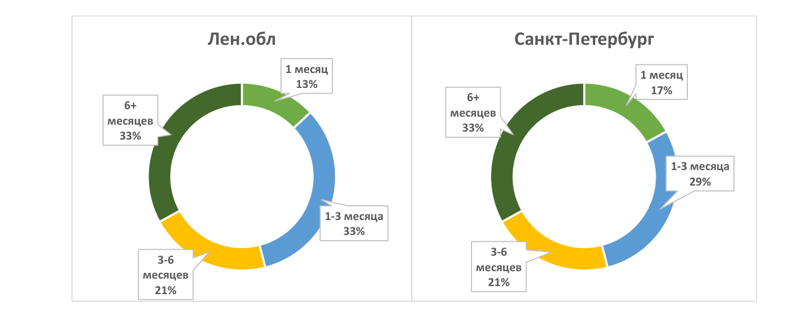
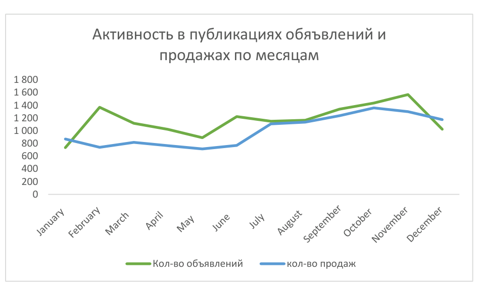
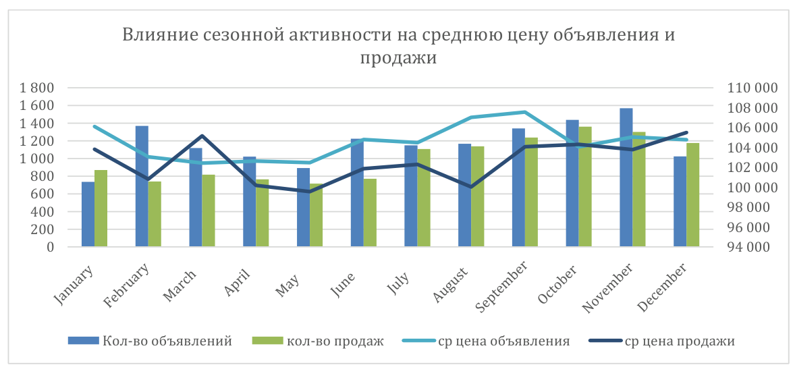
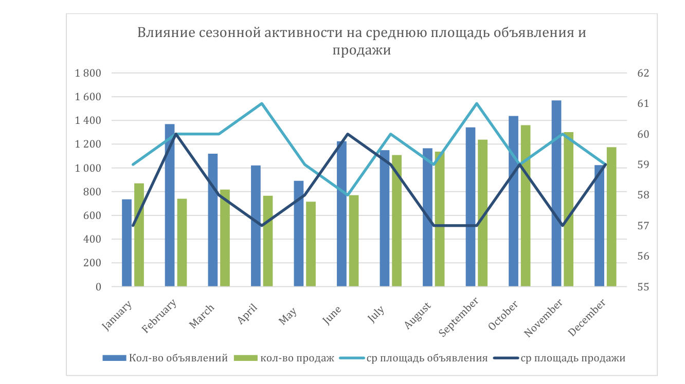

# Анализ рынка недвижимости Санкт-Петербурга и Ленинградской области

## О проекте

Учебный аналитический проект, выполненный в рамках программы «Аналитик данных» Яндекс Практикума.

**Цель проекта:** исследовать рынок недвижимости Санкт-Петербурга и городов Ленинградской области, выявить особенности активности объявлений, сезонные закономерности и сформулировать рекомендации для агентства недвижимости.

## Инструменты

- PostgreSQL, SQL
- CTE, JOIN, оконные функции, агрегирование
- Yandex DataLens
- Визуализация и интерпретация данных

## Данные

Использовались данные объявлений о продаже недвижимости за 2015–2018 годы. Анализ ограничен городскими населёнными пунктами. Для обработки выбросов применялись пороговые значения на основе перцентилей.

### Ограничения проекта

Анализ выполнен на учебной базе данных Яндекс Практикума. В настоящее время доступ к исходной базе закрыт, поэтому повторное выполнение SQL-запросов и обновление дашборда Yandex DataLens недоступны. В репозитории представлены SQL-код, аналитический отчёт и визуализации, подготовленные в ходе выполнения проекта.

## Задачи исследования

1. Проанализировать продолжительность активности объявлений в Санкт-Петербурге и Ленинградской области.
2. Сравнить характеристики объектов недвижимости и стоимость квадратного метра.
3. Определить сезонность публикации и снятия объявлений.
4. Сформулировать рекомендации для агентства недвижимости.

## Основные результаты

- Средняя стоимость квадратного метра в Санкт-Петербурге — 112 139 ₽, в городах Ленинградской области — 68 768 ₽.
- Объекты большей площади, как правило, имеют более длительный срок активности объявления.
- Максимальная активность публикации объявлений наблюдалась в ноябре, снятия объявлений — в октябре.
- Повышенная активность на рынке недвижимости наблюдалась во втором полугодии.
  
## Визуализация результатов

### Продолжительность активности объявлений

### Сезонность рынка недвижимости

### Динамика стоимости квадратного метра

### Динамика средней площади объектов

## Выводы

Полученные результаты могут использоваться для выбора приоритетных сегментов недвижимости, оценки рыночной активности и планирования маркетинговых кампаний.

## Материалы проекта

- [SQL-запросы исследования](analysis.sql)
- [Аналитический отчёт](reports/real_estate_analysis_report.pdf)
- [Визуализации](images/)

## Дашборд Yandex DataLens

[Открыть дашборд](https://datalens.yandex/im3ikv7ovjba3?_share_link=public)

**Статус:** исходный источник данных отключён, поэтому дашборд в настоящее время не отображает результаты. Основные результаты исследования представлены в аналитическом отчёте.

---

[Вернуться к портфолио](../README.md)
